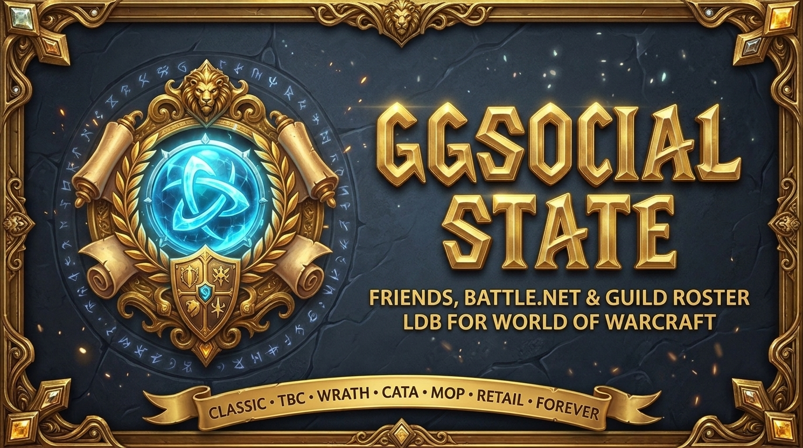

  

  # GGSocialState

  **Modern Dark-Gold LibDataBroker Friends, Battle.net & Guild Roster Tooltip with Full GuildGreet Extended Integration!**

  
  
  
  
  
  
  
  

---

**GGSocialState** is a rich **LibDataBroker-1.1 (LDB)** and Minimap social display for World of Warcraft that combines your **Guild Roster**, **Character Friends**, and **Battle.net RealID Friends** into a unified, interactive **Dark-Slate & Gold `LibQTip-1.0` Tooltip** — with native **GuildGreet Extended** Main/Alt & Alias integration.

---

## 🎮 Supported WoW Versions

- **Retail (Midnight `12.x` & The War Within `11.2.x`)**
- **Mists of Pandaria Classic (`5.5.x`)**
- **Cataclysm Classic (`4.4.x`)**
- **Wrath of the Lich King Classic (`3.4.x` / `3.8.x`)**
- **The Burning Crusade Classic Anniversary (`2.5.x`)**
- **Classic Era (`1.15.x`) & Classic Forever (`1.60.x` / `16001`)**

---

## ✨ Key Features

- 🖥️ **Modern Dark-Slate & Gold Interactive Tooltip (`LibQTip-1.0`)**:
  - Top header banner with addon icon, version badge, live online counters for **Guild** and **Friends / Battle.net**, and compact Guild Message of the Day (MOTD).
  - Shaded section headers, gold separators, zebra-striped rows, class-colored character names, level colors, zone names, realm names, guild ranks, public/officer notes, and **GuildGreet Main/Alias** columns.
- 🤝 **Native GuildGreet Extended Integration**:
  - Automatically displays each guild member's configured **Main character** or **Alias** from **GuildGreet Extended** directly inside the roster tooltip.
- 🖱️ **Quick Click Actions**:
  - **Left-Click Player**: Whisper player (`/w`).
  - **Alt + Left-Click Player**: Invite player to party.
  - **Shift + Left-Click Player**: Query `/who` information.
  - **Ctrl + Left-Click / Right-Click**: Edit public or officer guild notes.
  - **Middle-Click LDB / Minimap Button**: Toggle individual tooltip sections (Friends, Guild, MOTD, Hint footer).
- 🧩 **LDB, Minimap, Addon Compartment & ElvUI Support**:
  - Works in any LDB display (*Titan Panel*, *Bazooka*, *ElvUI DataTexts*, *ChocolateBar*), as a standalone **`LibDBIcon-1.0` Minimap Button**, or inside Retail's **Addon Compartment**, with native **ElvUI** & **AddOnSkins** `Transparent` tooltip styling.

---

## 📜 Credits & Support

- **Authors**: Luzisto (Original Author), **gOOvER** (v2.0.0 Modernization & Dark-Gold UI)
- **License**: [GNU General Public License v3.0 (GPL-3.0)](LICENSE)
- **Support Development**: [donate.goover.dev](https://donate.goover.dev) • [Ko-fi](https://ko-fi.com/oldnoob) • [Buy Me a Coffee](https://www.buymeacoffee.com/goover)

